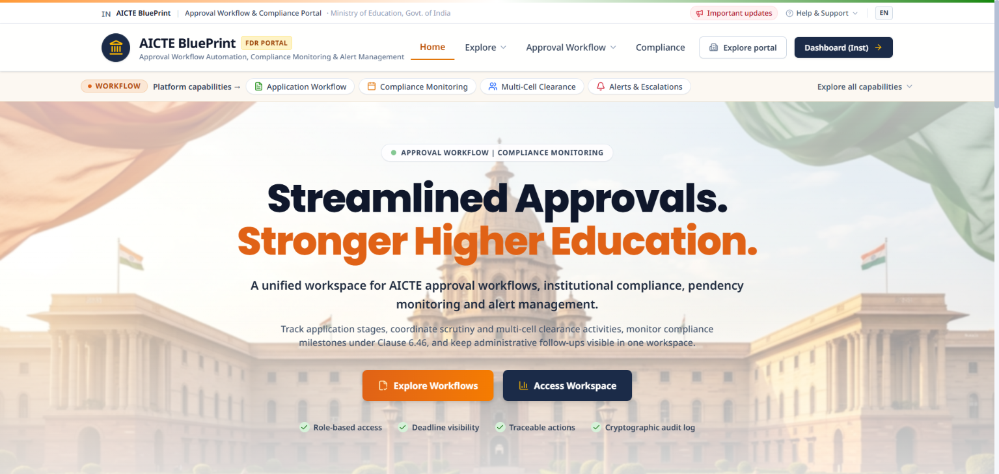
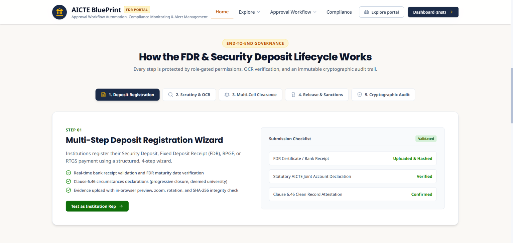
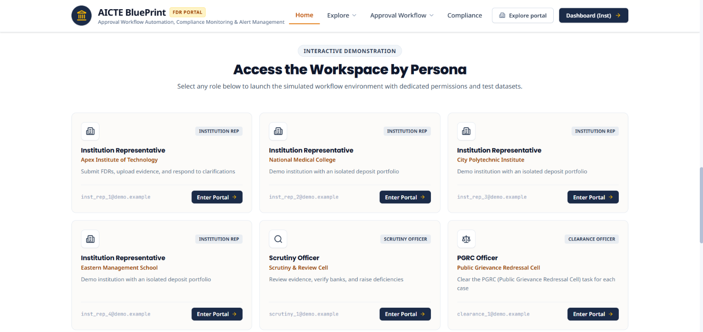
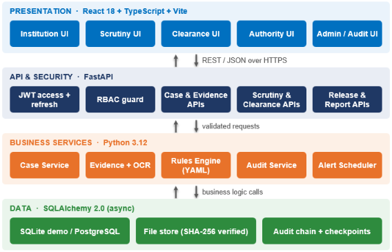

# SIH26265 — AICTE Security Deposit & FDR Portal


A secure, audit-compliant digital portal for the **AICTE Security Deposit / Fixed Deposit Receipt (FDR) / RPGF / RTGS** lifecycle. It models end-to-end institution deposit submission, document verification, multi-cell scrutiny and clearance, authority authorisation, and cryptographic audit logging.

> **Team name:**  QUANSTACK <-> **Team ID:**  197720 

---


| | | |
|:---:|:---:|:---:|
|  |  |  |

---

## Table of Contents

1. [Overview](#overview)
2. [Key Features](#key-features)
3. [System Architecture](#system-architecture)
4. [Workflow](#workflow)
5. [User Personas & Demo Accounts](#user-personas--demo-accounts)
6. [Demo Walkthrough](#demo-walkthrough)
7. [Tech Stack](#tech-stack)
8. [Getting Started](#getting-started)
   - [Prerequisites](#prerequisites)
   - [Backend Setup](#backend-setup)
   - [Frontend Setup](#frontend-setup)
   - [Database Seeding](#database-seeding)
   - [Running the Application](#running-the-application)
9. [Operational Scripts](#operational-scripts)
10. [Testing & Quality Assurance](#testing--quality-assurance)
11. [Security & Compliance Architecture](#security--compliance-architecture)
12. [Project Structure](#project-structure)
13. [FAQ](#faq)
14. [Troubleshooting](#troubleshooting)
15. [Limitations & Roadmap](#limitations--roadmap)
16. [References](#references)
17. [License](#license)

---

## Overview

| | |
|---|---|
| **Problem Statement ID** | SIH26265 |
| **Domain** | Governance automation: AICTE security deposit / FDR management |
| **Category** | Software |
| **Instruments covered** | FDR, RPGF (via Approval Bureau NOC) and RTGS refunds (via Council Sanction Order) |

**The problem.** Releasing an institution's security deposit needs sign-off from several offices. Hand-offs between them are hard to track, maturity dates are easy to miss, and there is no tamper-evident record of who decided what.

**Our approach.** One role-based portal where an institution submits a case once, officers review it in dedicated queues, three independent cells clear it, a competent authority releases it only after a regulatory checklist passes, and every step is written to a hash-chained audit log.

**Quick start (TL;DR).**

```bash
python -m venv .venv && source .venv/bin/activate      # Windows: .\.venv\Scripts\Activate.ps1
pip install -r requirements.txt && cp .env.example .env
python scripts/reset_demo.py --yes && python scripts/seed_demo.py
python -m uvicorn backend.main:app --reload --port 8000   # terminal 1
cd frontend && npm ci && npm run dev                       # terminal 2 -> http://localhost:5173
```

---

## Key Features

- **Multi-step case registration**: a wizard guides institutions through deposit details, regulatory declarations and document uploads.
- **Intelligent evidence management**
  - Secure upload supporting PDF, JPEG, PNG and TIFF.
  - Interactive viewer with in-browser PDF preview, image zoom/rotation, full-screen mode and download fallback.
  - OCR pipeline that extracts structured metadata (FDR numbers, bank names, maturity dates, amounts).
  - SHA-256 integrity verification and automated synthetic fallback generation in demo mode.
- **Scrutiny & review workflow**
  - Real-time scrutiny queues with status filtering and metrics.
  - Clarification requests with institution document re-submission.
  - Case assignment and strict status-transition validation.
- **Independent multi-officer clearance**
  - Separate queues for the **Public Grievance Redressal Cell (PGRC)**, **Vigilance Cell** and **Technical Cell / Bureau**.
  - Distinct task ownership: every clearance must be complete before a case is release-ready.
- **Authority release authorisation**
  - FDR/RPGF release via **Approval Bureau NOC**; RTGS refund via **Council Sanction Order**.
  - **Clause 6.46** checklist gating (progressive closure, deemed-university status, embezzlement, mergers).
- **Cryptographic audit trail**
  - Append-only, hash-chained log: `SHA-256(prev_hash + entity + action + actor + timestamp)`.
  - Periodic checkpoint signatures and a local chain-verification utility.
- **Monitoring, alerts & reports**
  - Persona-scoped operational reports with CSV export.
  - Alert scheduler for maturity warnings (30/60/90 days), pending clarifications and overdue clearance tasks.

---

## System Architecture

<!--
  TODO: export your architecture diagram and save it as docs/images/architecture.png
  (the image below will then render automatically).
-->



*Figure 1: Layered architecture. React client → FastAPI (JWT + RBAC) → business services → data stores.*

---

## Workflow

**Workflow Of The Prototype**

```
[ Institution ]
      │  Creates deposit case & uploads evidence (FDR / Bank Guarantee / RTGS)
      ▼
[ Scrutiny Officer ]
      │  Reviews case & evidence
      ├─► Requests clarification ──► Institution updates evidence
      └─► Approves & moves to clearance queue
      ▼
[ Clearance Officers ]  (three independent reviews)
      ├── Public Grievance Redressal Cell (PGRC)
      ├── Vigilance Cell
      └── Technical Cell / Bureau
      ▼
[ Competent Authority ]  (Approval Bureau / Council)
      │  Evaluates release checklist & Clause 6.46 gates
      ▼
[ Release decision recorded ]
      │  Simulated Approval Bureau NOC (FDR/RPGF) / Council Sanction Order (RTGS)
      ▼
[ Cryptographic audit log ]  (record of every state change and action)
```

---

## User Personas & Demo Accounts

All demo accounts use the password **`demo12345`** (demo data only; change or remove these accounts before any real deployment).

| Role | Email | Description |
|---|---|---|
| **Institution Representative** | `inst_rep_1@demo.example` | Creates and manages deposit cases, uploads documents, requests release or renewal |
| **Scrutiny Officer** | `scrutiny_1@demo.example` | Inspects submitted cases, reviews OCR metadata, requests clarifications, approves scrutiny |
| **Clearance Officer (PGRC)** | `clearance_1@demo.example` | Processes Public Grievance Redressal Cell clearances |
| **Clearance Officer (Vigilance)** | `clearance_2@demo.example` | Conducts Vigilance Cell reviews and clearance decisions |
| **Clearance Officer (Technical)** | `clearance_3@demo.example` | Evaluates Technical Cell / Bureau clearances |
| **Competent Authority** | `authority_1@demo.example` | Reviews overall case readiness and authorises release |
| **Approval Bureau** | `approval_bureau_1@demo.example` | Authority for FDR/RPGF NOC issuance |
| **Council Authority** | `council_1@demo.example` | Authority for RTGS sanction orders |
| **System Administrator** | `admin_1@demo.example` | System administration, audit inspection and queue governance |

---

## Demo Walkthrough

A suggested 5-minute path through the whole lifecycle (log in as each persona in turn):

1. **Institution** (`inst_rep_1`): create a new case with the wizard and upload an FDR document. Note the OCR-extracted fields.
2. **Scrutiny Officer** (`scrutiny_1`): open the case, review the OCR metadata, then either request a clarification (switch back to the institution to respond) or approve.
3. **Clearance Officers** (`clearance_1`, `clearance_2`, `clearance_3`): clear the case from each cell. Observe that release is blocked until all three are done.
4. **Competent Authority** (`authority_1`): review the Clause 6.46 checklist and authorise release. FDR/RPGF cases go to the **Approval Bureau** (`approval_bureau_1`); RTGS cases go to the **Council** (`council_1`).
5. **System Administrator** (`admin_1`): inspect the audit trail, then run `python scripts/verify_audit.py` to confirm the chain is intact.

---

## Tech Stack

| Layer | Technologies |
|---|---|
| **Backend** | Python 3.12+, FastAPI, SQLAlchemy 2.0 (asyncio), Pydantic |
| **Database** | SQLite (default demo) / PostgreSQL |
| **Security** | JWT (access + signed refresh tokens), Argon2 / Bcrypt hashing, role-based access control (RBAC), SHA-256 |
| **Documents** | PyPDF2, Pytesseract (OCR), Pillow |
| **Frontend** | React 18, TypeScript, Vite, Tailwind CSS, Vanilla CSS design tokens, Lucide React |
| **State & HTTP** | Context API, Axios / Fetch API |
| **Testing** | Pytest, Pytest-Asyncio, HTTPX |

---

## Getting Started

### Prerequisites

- **Python** 3.12 or newer
- **Node.js** 18.x or newer (with npm)
- **Git**
- **Tesseract OCR** installed on your system (needed by Pytesseract for real OCR; see [Troubleshooting](#troubleshooting))

### Backend Setup

1. **Create and activate a virtual environment**

   *Windows PowerShell*

   ```powershell
   python -m venv .venv
   .\.venv\Scripts\Activate.ps1
   ```

   *macOS / Linux*

   ```bash
   python3 -m venv .venv
   source .venv/bin/activate
   ```

2. **Install dependencies**

   ```bash
   python -m pip install --upgrade pip
   pip install -r requirements.txt
   ```

3. **Configure the environment**

   ```bash
   cp .env.example .env        # Windows PowerShell: Copy-Item .env.example .env
   ```

   Keep `DEMO_MODE=true` for demonstration and synthetic data generation.

### Frontend Setup

```bash
cd frontend
npm ci
cd ..
```

### Database Seeding

Initialise the schema and load repeatable synthetic demo records:

```bash
python scripts/reset_demo.py --yes
python scripts/seed_demo.py
```

### Running the Application

Start the backend and frontend in separate terminals.

**Terminal 1: backend API**

```bash
python -m uvicorn backend.main:app --reload --port 8000
```

- Swagger API docs: <http://localhost:8000/docs>
- ReDoc: <http://localhost:8000/redoc>

**Terminal 2: frontend client**

```bash
cd frontend
npm run dev
```

- Web application: <http://localhost:5173>

---

## Operational Scripts

| Purpose | Command |
|---|---|
| Reset demo data | `python scripts/reset_demo.py --yes` |
| Seed demo data | `python scripts/seed_demo.py` |
| Run the lifecycle alert engine (maturing instruments, overdue clearances, unresolved clarifications) | `python scripts/run_alerts.py` |
| Verify the audit chain (SHA-256 continuity; detects manual database tampering) | `python scripts/verify_audit.py` |

On Windows you can also use backslashes (`scripts\reset_demo.py`).

---

## Testing & Quality Assurance

Run the automated suite (60+ unit and integration tests) and check frontend type safety:

```bash
# Backend
export PYTHONPATH="$(pwd)"            # PowerShell: $env:PYTHONPATH = (Get-Location).Path
pytest -v

# Frontend type-check and production build
cd frontend
npm run build
cd ..
```

---

## Security & Compliance Architecture

1. **Blockchain-based cryptographic hash chaining (Ethereum Sepolia)**: every lifecycle event (case submission, review decision, clearance approval, document upload) records a SHA-256 hash linked to the previous block forming a tamper-evident chain. The cumulative audit root hash is anchored on-chain by submitting an Ethereum transaction to the **Sepolia testnet** — making the audit trail publicly verifiable and immutable even outside the application database. The on-chain transaction hash (`txHash`) is stored alongside each audit block and can be inspected on Sepolia Etherscan.
2. **Access control**: fine-grained RBAC enforces endpoint authorisation across institution representatives, scrutiny officers, clearance officers, authorities and administrators.
3. **Audit immutability**: serialised JSON audit payloads normalise dates, decimals and UUIDs so hash calculation is deterministic across platforms. The SHA-256 chain root is periodically anchored to the Ethereum Sepolia blockchain, providing an independent, decentralised proof-of-integrity layer beyond the application's own database.
4. **Regulatory Clause 6.46 compliance**: built-in checklist gates evaluate progressive closure, university conversion, financial-dispute holds and institution mergers before release authorisation.

---

## Project Structure

```
sih26fdr/
├── backend/
│   ├── config.py              # Application settings & environment config
│   ├── database.py            # Async SQLAlchemy engine & session factory
│   ├── main.py                # FastAPI entry point & router registration
│   ├── models/                # SQLAlchemy models (Case, Evidence, Audit, User)
│   ├── routes/                # API endpoints (Auth, Cases, Evidence, Scrutiny, Clearance, Release, Reports)
│   ├── schemas/               # Pydantic validation models
│   └── services/              # Business logic (CaseService, AuditService, FileStorage, OCR, Rules)
├── config/
│   └── rules.yaml             # Configurable regulatory checklist rules
├── docs/
│   └── images/                # Architecture, workflow diagrams and screenshots
├── frontend/
│   ├── src/
│   │   ├── api/               # API clients for cases, clearance, evidence, etc.
│   │   ├── components/        # UI components (DocumentViewer, Modals, Forms, Navigation)
│   │   ├── context/           # React context providers (AuthContext, etc.)
│   │   ├── pages/             # Persona-specific views (Institution, Scrutiny, Clearance, Authority, Admin)
│   │   └── types/             # TypeScript interfaces & enums
│   ├── package.json
│   └── vite.config.ts
├── scripts/                   # CLI maintenance & demo management scripts
└── tests/                     # Unit and integration test suites
```

---

## FAQ

**Q. Why does the workflow have so many user roles?**
To match how AICTE actually works. A deposit release passes through different offices, each with its own responsibility. Modelling them as separate roles keeps duties separated (nobody both reviews and approves their own case) and makes the system easier to scale: a new office or role can be added without redesigning the flow.

**Q. Why are there three separate clearance cells instead of one reviewer?**
PGRC, Vigilance and the Technical Cell look at different aspects of a case and are accountable independently. Each has its own queue and task ownership, and a case is not release-ready until all three have cleared it.

**Q. Why use a hash-chained audit log instead of ordinary logging?**
Ordinary logs can be edited without a trace. Here every entry includes the hash of the previous one, so changing or deleting a record breaks the chain. `scripts/verify_audit.py` re-checks the chain and flags tampering.

**Q. Does this move real money or use real AICTE data?**
No. The portal runs in synthetic demo mode with simulated banking and authorisation steps. Do not enter real financial or personal data.

**Q. How is OCR used, and what if it reads a document wrongly?**
OCR extracts structured fields (FDR number, bank, maturity date, amount) to save manual typing. The Scrutiny Officer reviews the extracted metadata alongside the original document, so a human confirms it before the case moves on. In demo mode, synthetic fallback documents can be generated automatically.

**Q. Why is the release step split between Approval Bureau and Council?**
The two instruments follow different authorisation paths: FDR/RPGF releases are issued as an **Approval Bureau NOC**, while RTGS refunds need a **Council Sanction Order**. The portal enforces the right path for each case type.

**Q. How are regulatory rules such as Clause 6.46 kept up to date?**
The checklist rules live in `config/rules.yaml` rather than being hard-coded, so they can be reviewed and adjusted when the handbook changes.

**Q. Why SQLite by default, and can this run on PostgreSQL?**
SQLite needs no setup, which makes the demo easy to run anywhere. The data layer uses SQLAlchemy 2.0 (async), and PostgreSQL is supported for production-style deployments.

**Q. Why FastAPI and React?**
FastAPI gives async performance, request validation through Pydantic and automatic API docs at `/docs`. React with TypeScript gives type-safe, persona-specific interfaces, and Vite keeps development fast.

---

## Troubleshooting

| Problem | Likely cause and fix |
|---|---|
| `ModuleNotFoundError: backend` when running pytest | `PYTHONPATH` is not set to the repo root. Set it as shown in [Testing](#testing--quality-assurance). |
| OCR returns nothing or raises a Tesseract error | The Tesseract binary is not installed or not on your `PATH`. Install it from the [Tesseract project](https://github.com/tesseract-ocr/tesseract) and restart the backend. |
| Login fails with demo accounts | The database has not been seeded. Run `python scripts/reset_demo.py --yes` then `python scripts/seed_demo.py`. |
| Frontend cannot reach the API | Confirm the backend is running on port 8000 and check `/docs` opens. |
| Port already in use | Stop the other process, or run on another port (`--port 8001`) and update the frontend API base URL. |
| Stale or broken demo data | Reset with `python scripts/reset_demo.py --yes` and reseed. |

---

## Limitations & Roadmap

**Current limitations**

- Demo / synthetic mode only: no real bank, FDR-verification or payment integration.
- Demo accounts and a shared password are for demonstration only.
- OCR quality depends on scan quality and the Tesseract installation.

**Planned**

- [x] Prototype: demo mode, synthetic data, 60+ automated tests
- [ ] Pilot: integration with AICTE portal and bank / FDR verification services
- [ ] Hardening: PostgreSQL deployment, security audit, load testing
- [ ] Scale: roll-out to all regional offices and institutions

---

## References

1. AICTE Approval Process Handbook 2022-23, section 7.51, *Release of Security Deposit*: <https://pmcaresforchildren.in/public/web-design/images/AICTE-APH-2022-23-pages-31-116-PMCARES-for-children.pdf>
2. AICTE, *Simple steps for making Security Deposit online*: <https://aicte.gov.in/sites/default/files/Security_Deposit.pdf>
3. AICTE HQ notice, *Release of FDRs created by Technical Institutes established in 2010-11*: <https://aicte.gov.in/sites/default/files/Message%20for%20portal.pdf>
4. Lok Sabha reply on FDRs pledged jointly in the name of AICTE and the institution: <https://eparlib.nic.in/bitstream/123456789/439331/1/53245.pdf>
5. NIST FIPS 180-4, *Secure Hash Standard (SHA-256)*: <https://csrc.nist.gov/pubs/fips/180-4/upd1/final>
6. Crosby & Wallach, *Efficient Data Structures for Tamper-Evident Logging*, USENIX Security 2009: <https://www.usenix.org/legacy/event/sec09/tech/full_papers/crosby.pdf>
7. FastAPI documentation, *Security*: <https://fastapi.tiangolo.com/tutorial/security/>

---

## License

This project is developed for the Smart India Hackathon (SIH 2026) demonstration.
